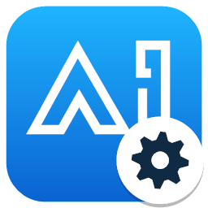
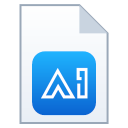

  <picture>
    <source media="(prefers-color-scheme: dark)" srcset="branding/makeai-seb-logo-dark.png">
    
  </picture>

<h1 align="center">MakeAI SEB</h1>

  <b>Ứng dụng trình duyệt thi an toàn dành cho các bài kiểm tra trên <a href="https://edu.makeai.vn">MakeAI</a>.</b>

  
  
  
  

  <a href="https://github.com/duytrinhmakeai/seb/releases/download/v1.0.3/MakeAISEB-1.0.3.0-x64-setup.zip"><b>⬇ Tải MakeAI SEB 1.0.3</b></a> (máy thi) ·
  <a href="https://github.com/duytrinhmakeai/seb/releases/download/v1.0.3/MakeAISEB-1.0.3.0-x64-Full-setup.zip">Bản Full</a> (giáo viên, kỹ thuật viên)

MakeAI SEB giúp mở bài thi trong môi trường được kiểm soát, hạn chế truy cập các ứng dụng và tài nguyên không được phép
trong thời gian làm bài. MakeAI SEB được phát triển dựa trên nền tảng Safe Exam Browser (SEB) và được tùy chỉnh cho hệ
thống thi của MakeAI.

Phiên bản mới nhất: **1.0.3** · Trang tải chính thức: https://github.com/duytrinhmakeai/seb/releases

**Mục lục:** [Tải ứng dụng](#01--tải-ứng-dụng) · [Yêu cầu máy tính](#yêu-cầu-máy-tính) · [Cài đặt](#02--cài-đặt) ·
[Bắt đầu bài thi](#03--bắt-đầu-bài-thi) · [Khi gặp sự cố](#khi-gặp-sự-cố) · [Gỡ cài đặt](#gỡ-cài-đặt) ·
[Kiểm tra toàn vẹn](#kiểm-tra-toàn-vẹn-sha-256) · [Bộ nhận diện](#bộ-nhận-diện)

---

## 01 · Tải ứng dụng

Chọn bộ cài đặt Windows phù hợp:

| Bộ cài | Dành cho | Tải về |
|---|---|---|
| **MakeAI SEB** | Máy thi của sinh viên: chỉ có ứng dụng thi | [setup.zip (196 MB)](https://github.com/duytrinhmakeai/seb/releases/download/v1.0.3/MakeAISEB-1.0.3.0-x64-setup.zip) · [.msi (197 MB)](https://github.com/duytrinhmakeai/seb/releases/download/v1.0.3/MakeAISEB-1.0.3.0-x64.msi) |
| **MakeAI SEB Full** | Giáo viên, kỹ thuật viên: thêm công cụ cấu hình và công cụ khôi phục | [setup.zip (197 MB)](https://github.com/duytrinhmakeai/seb/releases/download/v1.0.3/MakeAISEB-1.0.3.0-x64-Full-setup.zip) · [.msi (198 MB)](https://github.com/duytrinhmakeai/seb/releases/download/v1.0.3/MakeAISEB-1.0.3.0-x64-Full.msi) |

**Máy Windows 10 32-bit** (thử nghiệm): dùng bộ cài x86 dưới đây. Mọi máy Windows 64-bit và Windows 11 dùng bộ cài ở bảng trên.
Xem loại máy: **Settings** → **System** → **About** → **System type** ("32-bit operating system" là máy 32-bit).

| Bộ cài (32-bit) | Dành cho | Tải về |
|---|---|---|
| **MakeAI SEB (x86)** | Máy thi chạy Windows 10 32-bit | [setup.zip (174 MB)](https://github.com/duytrinhmakeai/seb/releases/download/v1.0.3/MakeAISEB-1.0.3.0-x86-setup.zip) · [.msi (175 MB)](https://github.com/duytrinhmakeai/seb/releases/download/v1.0.3/MakeAISEB-1.0.3.0-x86.msi) |
| **MakeAI SEB Full (x86)** | Giáo viên, kỹ thuật viên dùng máy 32-bit | [setup.zip (175 MB)](https://github.com/duytrinhmakeai/seb/releases/download/v1.0.3/MakeAISEB-1.0.3.0-x86-Full-setup.zip) · [.msi (176 MB)](https://github.com/duytrinhmakeai/seb/releases/download/v1.0.3/MakeAISEB-1.0.3.0-x86-Full.msi) |

**Máy Mac** (thử nghiệm; đã ký số và được Apple công chứng): [MakeAISEB-1.0.3-mac.dmg (38 MB)](https://github.com/duytrinhmakeai/seb/releases/download/v1.0.3/MakeAISEB-1.0.3-mac.dmg) · macOS 10.15 trở lên, máy Intel và Apple Silicon (M1/M2/M3…).
Mở file .dmg, kéo **MakeAI SEB** vào **Applications**. Cấp quyền **Accessibility**, **Screen Recording**, **Camera** và **Full Disk Access** khi được hỏi. Hướng dẫn chi tiết có trong file `HUONG-DAN-CAI-DAT.txt` bên trong .dmg.

Chỉ cần tải **một** trong hai dạng: `.msi` (chạy trực tiếp) hoặc `setup.zip` (giải nén ra được file `.msi`).
[Thay đổi trong phiên bản](https://github.com/duytrinhmakeai/seb/releases/tag/v1.0.3) ·
[SHA256SUMS.txt](https://github.com/duytrinhmakeai/seb/releases/download/v1.0.3/SHA256SUMS.txt)

### Yêu cầu máy tính

- Máy Mac: macOS 10.15 trở lên (bản thử nghiệm, xem mục tải ở trên).
- Windows 10 phiên bản 1903 trở lên hoặc Windows 11, 64-bit (bộ cài x64); hoặc Windows 10 phiên bản 1903 trở lên, 32-bit (bộ cài x86).
- Microsoft Visual C++ Redistributable 2015–2022 đúng loại máy, nếu máy chưa có thì tải và cài trước:
  [bản x64](https://aka.ms/vs/17/release/vc_redist.x64.exe) cho máy 64-bit · [bản x86](https://aka.ms/vs/17/release/vc_redist.x86.exe) cho máy 32-bit.
- Webcam nếu kỳ thi yêu cầu giám sát camera.
- Chỉ 1 màn hình: rút màn hình phụ hoặc máy chiếu trước khi thi.

## 02 · Cài đặt

1. Tải bộ cài ở bảng trên (nếu tải file `.zip` thì giải nén ra).
2. Nhấp đúp file `.msi`.
3. Đồng ý điều khoản, bấm **Install**. Windows hỏi quyền quản trị (UAC): chọn **Yes**.
   Cần tài khoản có quyền Administrator trên máy.
4. Khởi động lại máy nếu hệ điều hành yêu cầu.

Cài xong, trong Start Menu sẽ có:

| Bộ cài | Start Menu |
|---|---|
| MakeAI SEB | MakeAI SEB |
| MakeAI SEB Full | MakeAI SEB · MakeAI SEB Configuration Tool · MakeAI SEB Reset Utility |

> Nếu Windows hiện **"Windows protected your PC"** (SmartScreen): bấm **More info** → **Run anyway**.
> Bộ cài hiện chưa được ký số, cảnh báo này là bình thường.

- Cài bản mới đè lên bản cũ sẽ tự nâng cấp, không cần gỡ trước. Cài bộ thường đè lên bộ Full (hoặc ngược lại) sẽ tự thay thế.
- Cài hàng loạt (quản trị mạng, quyền Administrator): `msiexec /i MakeAISEB-1.0.3.0-x64.msi /qn` (máy 32-bit: `MakeAISEB-1.0.3.0-x86.msi`)

## 03 · Bắt đầu bài thi

**Cách 1 – Từ trang bài thi trên MakeAI:**

1. Đăng nhập MakeAI và mở bài thi được yêu cầu dùng SEB.
2. Nhấn **Chạy MakeAI SEB** trên trang hướng dẫn của bài thi.
3. Cho phép trình duyệt mở ứng dụng MakeAI SEB khi được hỏi.

**Cách 2 – File cấu hình `.seb`** (do giáo viên hoặc nhà trường gửi): nhấp đúp file `.seb`, MakeAI SEB tự mở và vào bài thi.

**Trong giờ thi:**

- Máy chuyển sang màn hình thi riêng, không chuyển được sang ứng dụng khác.
- Nếu được hỏi đồng ý giám sát màn hình hoặc camera, bấm đồng ý để vào thi.
- Tắt trước các ứng dụng điều khiển từ xa, chat, quay màn hình (TeamViewer, UltraViewer, AnyDesk, Teams, Discord, OBS…).
  Nếu MakeAI SEB yêu cầu tắt, chọn đồng ý.
- Thoát: bấm nút thoát trên thanh tác vụ của MakeAI SEB (cần mật khẩu thoát do giám thị cung cấp)
  hoặc nộp bài theo hướng dẫn của bài thi.

### Lưu ý trước khi thi

- Hãy cài MakeAI SEB trước giờ thi và kiểm tra ứng dụng trên đúng máy sẽ làm bài.
- Đóng các ứng dụng khác trước khi bắt đầu bài thi.
- Nếu ứng dụng báo thiếu dịch vụ bảo mật hoặc không thể khởi động, hãy liên hệ quản trị viên.

---

## Tính năng

| | |
|---|---|
| **Chế độ thi tập trung** | Giới hạn việc chuyển sang ứng dụng và tài nguyên khác theo cấu hình của kỳ thi. |
| **Mở bài thi nhanh** | Khởi động bài thi bằng file cấu hình hoặc nút Chạy MakeAI SEB trên Moodle. |
| **Hỗ trợ giám sát** | Hỗ trợ camera và màn hình khi kỳ thi được cấu hình yêu cầu giám sát. |
| **Dịch vụ bảo mật** | Dịch vụ MakeAI SEB tự đưa máy về trạng thái bình thường sau khi thi; bản Full có thêm công cụ khôi phục. |
| **Tiếng Việt** | Giao diện tiếng Việt mặc định; công cụ cấu hình và công cụ khôi phục có thêm tiếng Anh (menu **Ngôn ngữ / Language**). |

Công cụ của bộ Full:

- **MakeAI SEB Configuration Tool:** tạo và sửa file cấu hình `.seb` (trang được mở, mật khẩu thoát, khóa phím, giám sát…).
- **MakeAI SEB Reset Utility:** đưa các thiết lập Windows mà MakeAI SEB đã thay đổi về trạng thái bình thường (cần quyền Administrator).

## Khi gặp sự cố

| Sự cố | Cách xử lý |
|---|---|
| Máy không trở lại bình thường sau khi thoát (mất Task Manager, không đăng xuất được…) | Khởi động lại máy hoặc đăng xuất rồi đăng nhập lại: dịch vụ MakeAI SEB tự khôi phục. Nếu vẫn chưa được: kỹ thuật viên cài bộ Full và chạy **MakeAI SEB Reset Utility**. |
| Báo lỗi "dịch vụ MakeAI SEB không chạy" | Cài lại bằng file `.msi`. |
| Báo lỗi màn hình | Rút màn hình phụ, tắt chế độ mở rộng (**Win + P** → **PC screen only**). |
| Cần gửi nhật ký lỗi cho bộ phận hỗ trợ | Nén thư mục `%LocalAppData%\SafeExamBrowser\Logs` (gõ đường dẫn này vào thanh địa chỉ của File Explorer). |

## Gỡ cài đặt

**Settings** → **Apps** → **Installed apps** → **MakeAI SEB (x64)** hoặc **MakeAI SEB Full (x64)** (máy 32-bit: **(x86)**) → **Uninstall**.

## Kiểm tra toàn vẹn (SHA-256)

Đối chiếu mã dưới đây sau khi tải file để kiểm tra file không bị thay đổi
(PowerShell: `Get-FileHash .\<tên file> -Algorithm SHA256`).

| Tệp | SHA-256 |
|---|---|
| `MakeAISEB-1.0.3.0-x64-setup.zip` | `c043362ba39a2fd5222491e669d9c122eef01916369747c6c6af810d4cd84b9c` |
| `MakeAISEB-1.0.3.0-x64.msi` | `f7f0ad4afa4bd3269ee84425ca5862c902c2b6e26822f640e2f5be4356df0e78` |
| `MakeAISEB-1.0.3.0-x64-Full-setup.zip` | `b28e6deff2e8e7b334789e4fac27eddcb43a4aee3117ea22a71e4c6128023a06` |
| `MakeAISEB-1.0.3.0-x64-Full.msi` | `dc65d17c63a337794b60657be2b1cdd9292bcaa20b9477a866865c4121d95259` |
| `MakeAISEB-1.0.3.0-x86-setup.zip` | `c451a7343998c53b0ed6c10df26d9694f067ff494e8768bde7261abe56e4f566` |
| `MakeAISEB-1.0.3.0-x86.msi` | `1e7affac06b434897f320411adfc7267e51f4c5058c1ec0da9a070059b5c7586` |
| `MakeAISEB-1.0.3.0-x86-Full-setup.zip` | `1de8d13c3269426586675ad1f3b03f14d42ea4e1ce6853694890e85fc356e859` |
| `MakeAISEB-1.0.3.0-x86-Full.msi` | `97995c5bddfae80075c21d927d9659f258140992a1c1f44646eac167f50b55fa` |
| `MakeAISEB-1.0.3-mac.dmg` | `73334dfaf75bd72aeaa238468ffbab1c0ce3492c9b6a7a41d4352a5202be17ff` |

## Bộ nhận diện

  <picture>
    <source media="(prefers-color-scheme: dark)" srcset="branding/makeai-seb-logo-dark.png">
    
  </picture>

Logo MakeAI SEB: `makeai-seb-logo.png` (nền sáng) và `makeai-seb-logo-dark.png` (nền tối, chữ trắng).

|  |  |  |  |
|:---:|:---:|:---:|:---:|
| MakeAI SEB | Configuration Tool | Reset Utility | File cấu hình `.seb` |

Các tệp ảnh (PNG nền trong suốt) nằm trong thư mục [`branding/`](branding).

---

**MakeAI Education** · *Learn AI today. Make AI tomorrow.* · [edu.makeai.vn](https://edu.makeai.vn) ·
[Facebook](https://www.facebook.com/AIhubacademy)

Safe Exam Browser © ETH Zürich, IT Services, phát hành theo [Mozilla Public License 2.0](https://mozilla.org/MPL/2.0/).
